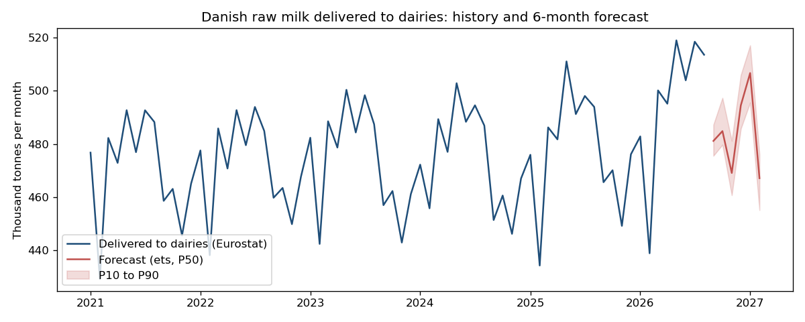
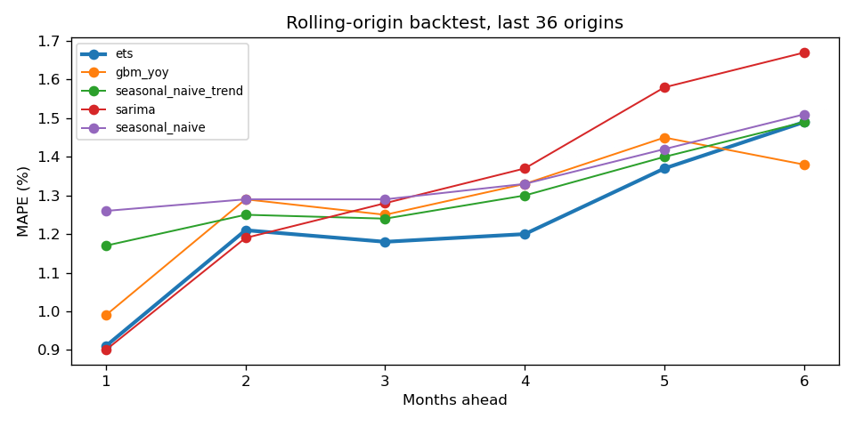
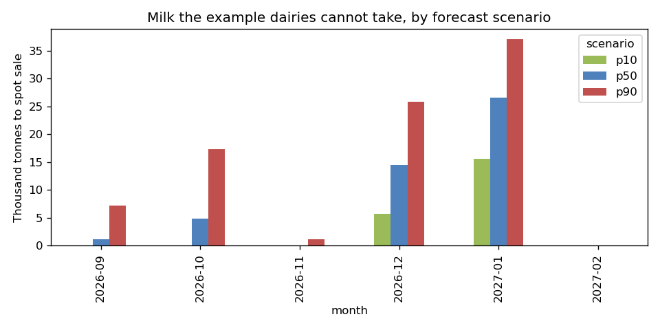

# milk-intake-forecast

Forecast how much raw milk Danish dairies will receive in the next six months, then turn that forecast into an allocation plan across dairies, once for a low, a middle and a high scenario.

It follows the planning chain from forecast to allocation to report: **forecast the intake, check how good the forecast really is, then plan with its uncertainty instead of a single number.** Portfolio project, 2026, by Bogdan Andone.



## What it does

| Step | What happens | Code |
|---|---|---|
| Data | Eurostat `apro_mk_colm`: raw cows' milk delivered to dairies in Denmark, monthly, thousand tonnes, plus its fat content. Snapshot committed in `data/raw/` (no API key). | `data.py` |
| Validation | Missing months, negative values and jumps over 25 % from the same month last year are reported before any model runs. Gaps are never filled silently. 2005 to August 2026: 260 months, no gaps, no jumps. | `data.validate` |
| Models | Seasonal naive (the baseline), seasonal naive with trend, Holt-Winters (damped trend, multiplicative season), SARIMA(1,1,1)(0,1,1)12 on log volume, gradient boosting on year-over-year growth. | `forecast.py` |
| Backtest | Rolling origin over the last 36 months: at each origin a model only sees data up to that month and forecasts 1 to 6 months ahead (a test asserts no training on the future). | `forecast.backtest` |
| Uncertainty | P10, P50 and P90 from the chosen model's own backtest errors per horizon. Coverage is checked out of sample: quantiles from the first half of the origins, coverage measured on the second half. | `forecast.forecast_with_intervals` |
| Allocation | A linear program (scipy, HiGHS) fills four example dairies by value per tonne, within each site's minimum intake and capacity; surplus goes to spot sale, and any shortfall below a minimum is penalised and reported. Solved for every month and every scenario. | `allocate.py` |
| Reporting | Tidy CSVs in `output/`, one fact per row, ready for Power BI: `history`, `backtest`, `scores`, `forecast`, `allocation`, `allocation_summary`. Plus three charts. | `report.py` |

```bash
pip install -r requirements.txt
PYTHONPATH=src python -m milkplan run --offline   # about 40 s, writes output/
pytest -q                                         # 16 tests, offline
```

## Results from the committed run

Data up to August 2026 (513.5 thousand tonnes, 4.38 % fat).

**Backtest, mean absolute percentage error by months ahead (36 origins):**

| Model | 1 | 2 | 3 | 4 | 5 | 6 | Mean |
|---|---:|---:|---:|---:|---:|---:|---:|
| **Holt-Winters (ets)** | **0.91** | **1.21** | **1.18** | **1.20** | **1.37** | 1.49 | **1.23** |
| Gradient boosting on yoy growth | 0.99 | 1.29 | 1.25 | 1.33 | 1.45 | **1.38** | 1.28 |
| Seasonal naive with trend | 1.17 | 1.25 | 1.24 | 1.30 | 1.40 | 1.49 | 1.31 |
| SARIMA | 0.90 | 1.19 | 1.28 | 1.37 | 1.58 | 1.67 | 1.33 |
| Seasonal naive (baseline) | 1.26 | 1.29 | 1.29 | 1.33 | 1.42 | 1.51 | 1.35 |

Holt-Winters is chosen. It beats the baseline by about 9 % on average and by about 28 % one month ahead, but the gain shrinks with the horizon: six months ahead, every model is within 0.3 points of "same month last year, adjusted for growth". The baseline is hard to beat for a series this seasonal, which is why it is in the table.



**Forecast with band (thousand tonnes):**

| Month | P10 | P50 | P90 |
|---|---:|---:|---:|
| 2026-09 | 475.5 | 481.1 | 487.2 |
| 2026-10 | 479.7 | 484.8 | 497.3 |
| 2026-11 | 460.7 | 469.1 | 481.2 |
| 2026-12 | 485.7 | 494.5 | 505.9 |
| 2027-01 | 495.5 | 506.6 | 517.0 |
| 2027-02 | 455.1 | 467.1 | 476.1 |

**The band is too narrow, and the repo says so.** An 80 % band should contain about 80 % of outcomes; out of sample, the Holt-Winters band contained 65 % (SARIMA 67 %, the naive models about 40 %). In a real plan I would widen it or use a longer error history before trusting P10 and P90 for decisions.

**Allocation.** The four example dairies can take 480 thousand tonnes a month. The plan per scenario shows how the uncertainty turns into a planning decision:

| Scenario | Milk to spot sale over 6 months | Peak month | Shortfall below minimums |
|---|---:|---|---:|
| P10 | 21.2 kt | January 2027: 15.5 kt | 0 |
| P50 | 47.0 kt | January 2027: 26.6 kt | 0 |
| P90 | 88.5 kt | January 2027: 37.0 kt | 0 |

January is the pressure point in every scenario: even the low case delivers more than the sites can process, so the question for a planner is extra capacity or an outlet for about 15 to 37 thousand tonnes, decided before the month starts.



## Databricks

`notebooks/databricks_one_intake.py` runs the same functions as a Databricks notebook (source format) and writes the six tables as Delta tables for the Power BI connector. **It is written for Databricks Free Edition but has not been run there yet;** the numbers above come from the local and CI runs.

## Honest limits

- **National data, not farm data.** Eurostat gives one Danish total per month. Real intake forecasting works per farm, region and route, and uses what farmers report about herd size, feed and weather. None of that is here.
- **The dairies are synthetic.** Names, minimums, capacities and values are examples sized to Danish volumes. They are not Arla sites or Arla priorities.
- **Fat is carried, not optimised.** The fat % is forecast with seasonal naive and reported in tonnes per site; the allocation balances milk volume only.
- **Scores are on the raw model output.** P50 is the model output corrected by its median backtest error; the MAPE table scores the uncorrected output.
- **The band under-covers** (see above).

## Tests and CI

16 offline tests: JSON-stat parsing, validation reports gaps instead of filling them, every model returns six future months, the backtest never trains on the future, P10 ≤ P50 ≤ P90, and the allocation respects supply, capacity and minimums, fills the most valuable site first and sends surplus to spot sale. CI runs the tests and the full pipeline on Python 3.11 and 3.12 and fails if the chosen model stops beating the baseline.

Data: Eurostat, `apro_mk_colm`, reused under the Eurostat copyright notice (free reuse with attribution).
